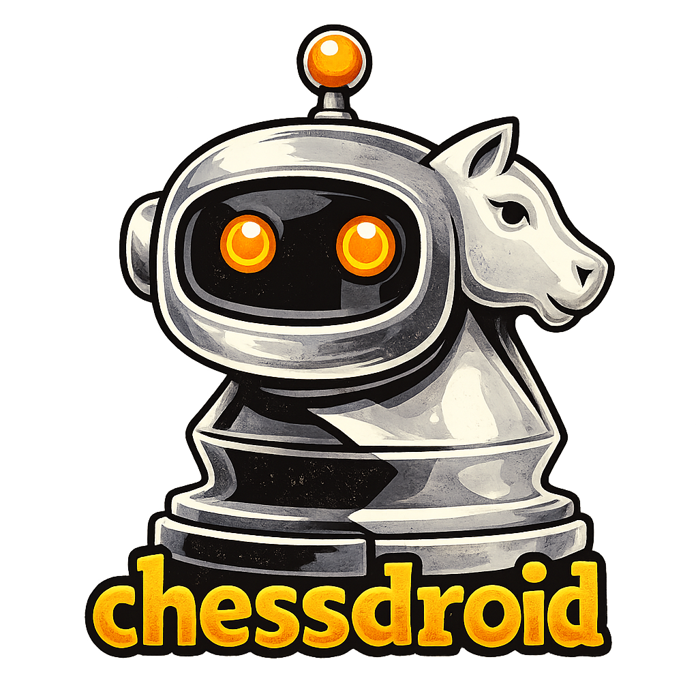

# chessdroid

[](https://dotnet.microsoft.com/download/dotnet/8.0)
[](https://www.microsoft.com/windows)
[](LICENSE)
[](CHANGELOG.md)

**Offline chess analysis & training for Windows**

chessdroid is a desktop application built for focused chess study. Analyze positions, explore ideas, run engine tournaments, and train with your favorite UCI engines — all on your computer, no internet required.



## Features

### Analysis Board
- **Interactive Chess Board** — Click or drag to make moves with legal move validation
- **Engine Arrows** — Colored arrows on the board showing engine recommended moves (green/yellow/red per PV line)
- **[See line]** — Click to load any PV line into the move tree as a variation with animated playback
- **Free-Draw Arrows** — Right-click to draw arrows from any square to any square for your own analysis
- **Move Tree with Variations** — Navigate through game history with full variation support, including PGN import/export of nested variations
- **Auto-Analysis** — Engine analysis runs automatically on every move, new game, and form open
- **PGN Import/Export** — Import games from any source (including multi-game PGN files, with a picker to choose which one), export your analysis
- **Move Classification** — Review games with Chess.com-style quality symbols (Brilliant !!, Blunder ??, Mistake ?, Inaccuracy ?!)
- **Move Quality Badge** — Colored symbol badge overlaid on the destination square during game navigation (teal=Brilliant, yellow=Inaccuracy, orange=Mistake, red=Blunder)
- **Evaluation Bar** — Visual representation of position evaluation with smooth transitions
- **Eval Graph** — Score history chart across all moves; click any point to navigate to that position
- **Piece Animations** — Smooth animated piece movement; castling animates the rook; configurable speed
- **FEN Support** — Load any position via FEN string or start from the standard position
- **Position Editor** — Set up any position piece by piece, including castling rights and side to move
- **Game Library** — Save analyzed games locally and reload them later, with accuracy scores and classification preserved

### Engine Matches, Bot Mode & Tournaments
- **Engine vs Engine** — Watch engines battle head-to-head on the analysis board
- **Play vs Bot** — Challenge any engine at a specific Elo (1320–3190) or preset (Beginner/Club/Advanced/Expert). Friendly or Challenge mode. Board auto-flips for Black; analysis keeps running.
- **Tournament Mode** — Run round-robin or manual-pairing tournaments across up to 4 simultaneous boards, with live standings, PGN export of every game, and optional Chessdroid rating updates
- **Chessdroid Rating Ladder** — A locally-calibrated Elo-style rating (seeded from each engine's CCRL rating, then drifting from games actually played in chessdroid) tracked per engine across 1v1 matches and tournaments
- **Chess 960 (Fischer Random)** — Full Fischer Random support with a position browser (960 positions), legal Chess960 castling, and Play vs Bot from any starting position
- **Configurable Time Controls** — Fixed Depth, Time per Move, or Total Time + Increment
- **Opening Books in Matches/Tournaments** — Start games from a random or chosen book opening instead of always the standard position
- **Start from Any Position** — Set up openings manually and have engines continue from there
- **Live Clock Display** — Real-time clock with active side highlighting

### Tactical Analysis
- **30+ Tactical Patterns** — Pins, forks, skewers, discovered attacks, zwischenzug, and more
- **Brilliant Move Detection** — Identifies piece sacrifices that maintain or improve position
- **Blunder Explanations** — Shows WHY moves are bad, not just that they are
- **Threat Detection** — Shows NEW threats created by each move
- **Defense Detection** — Shows defensive aspects of moves (protecting, blocking, escaping)
- **Static Exchange Evaluation (SEE)** — Internal evaluation for sacrifice and brilliant move detection

### Play Style & Analysis
- **Play Style Recommendations** — Style-based move suggestions (Very Solid → Very Aggressive)
- **WDL Display** — Win/Draw/Loss probabilities from engine analysis
- **Polyglot Opening Books** — Industry-standard .bin format with 1M+ positions
- **ECO Database** — 12,379+ opening positions with names and ECO codes
- **Multi-PV Analysis** — Display up to 3 best lines simultaneously with evaluations and explanations

### Endgame Analysis
- **Advanced Heuristics** — Rule of the square, opposition, king activity, fortress detection
- **Passed Pawn Evaluation** — Advancement bonuses and king tropism
- **Drawing Patterns** — Wrong color bishop, insufficient material, and more

### Endgame & Tactics Drills
- **10 Curated Drill Sets** — Practice studies spanning common endgame and tactical motifs
- **Drill vs Bot** — Play out a drill position against the engine, with the rest of the UI locked until the drill ends
- **Drill: Watch Engines** — Let two engines play out the drill position against each other while you observe

### Training & Study
- **Puzzle Training** — 5.94M Lichess puzzles with Rush mode (timed), Gauntlet (survival streak), and Daily Puzzle
- **Opening Training** — Recreate openings move by move; lifetime stats per opening (runs, perfect runs, mistakes, best run)
- **Vision Training** — Board coordinate recognition; Timed and Survival modes with personal bests
- **Square Training** — Easy and Challenge difficulty; PBs for White, Black, and Random square sets
- **Training Stats Dialog** — 📊 button opens a unified personal-best view across all training modes

### Endgame Tablebases
- **Syzygy tablebase support** — Offline 7-piece endgame lookup (zero API calls) via Stockfish's native Syzygy integration; configure path in Settings

### Customization
- **8 UI Themes** — Dark, Light, Cyberpunk, Dracula, Nord, Sepia, Solarized, Miami
- **Custom Board Colors** — Full RGB color picker for light and dark squares; colors persist across sessions
- **Board Effects** — Gradient fill, vignette overlay, piece glow, board frame with coordinate labels
- **Show Coordinates toggle** — Rank/file labels on or off globally
- **Piece Movement Mode** — Choose Click, Drag, or Both input styles; legal move dots shown on mousedown
- **Panel Layout** — Rearrange the Board / Moves / Analysis panels in any of 6 presets, applied live
- **Tabbed Settings** — General, Board, Engine, and Training tabs for easier navigation
- **Feature Toggles** — Customize analysis display (Tactical, Positional, Endgame, Opening, WDL, Engine Arrows, Eval Graph, Animations, etc.)
- **22 Piece Sets** — Switch between Chess.com, Lichess, Staunty, Merida, and many more

## Requirements

- **OS**: Windows 10/11 (64-bit)
- **.NET**: .NET 8.0 Runtime
- **Engine**: Any UCI-compatible chess engine (Stockfish recommended)

## Installation

### Option 1: Download Release (Recommended)

1. Download the latest release from the [Releases](../../releases) page
2. Extract the ZIP file to your preferred location
3. Run `chessdroid.exe`

### Option 2: Build from Source

```bash
# Clone the repository
git clone https://github.com/jio1337/chessdroid.git
cd chessdroid

# Restore dependencies
dotnet restore

# Build the project (builds chessdroid.sln: the App, Core, and test projects)
dotnet build --configuration Release

# Run the application
dotnet run --project src/ChessDroid.App/chessdroid.csproj --configuration Release
```

## Quick Start

1. **Launch chessdroid** — Run `chessdroid.exe`
2. **Configure Engine** — Click ⚙ Settings and select your UCI engine
3. **Make Moves** — Click or drag pieces to make moves on the board
4. **Read Analysis** — Analysis runs automatically after every move with explanations
5. **Import a Game** — Use Import PGN to analyze a complete game move by move

## Keyboard Shortcuts

| Shortcut | Action |
|----------|--------|
| `←` / `→` | Navigate moves (previous / next) |
| `↑` / `↓` | Switch between variations at the current position |
| `Home` / `End` | Jump to the start / end of the game |
| `Backspace` | Take back last move |
| `Ctrl+N` | New game |
| `Ctrl+F` | Flip board |

## Configuration

chessdroid stores settings in `config.json`. You can customize:

### Engine & Analysis
- **Selected Engine** — Choose from available UCI engines in the Engines folder
- **Engine Depth** — Analysis depth (1-40, default: 15)
- **Multi-PV Lines** — Show 2nd and 3rd best lines (optional)
- **Opening Book** — Enable/disable Polyglot opening book suggestions, point at your own `.bin` files
- **Syzygy Path** — Point at a folder of `.rtbw`/`.rtbz` tablebase files for offline endgame lookup

### Play Style
- **Aggressiveness** — 0-100 slider (0=solid, 50=balanced, 100=aggressive)

### Display & UI
- **Theme** — 8 built-in themes (Dark, Light, Cyberpunk, Dracula, Nord, Sepia, Solarized, Miami)
- **Panel Layout** — Rearrange Board / Moves / Analysis panels
- **Feature Toggles** — Enable/disable specific analysis features
- **Piece Set** — Choose from available template folders

## Technology Stack

- **.NET 8.0** — Application framework
- **WinForms** — User interface
- **UCI Protocol** — Chess engine communication
- **Service-Oriented Architecture** — `ChessDroid.Core` holds pure chess logic (no UI dependency); `ChessDroid.App` holds the WinForms UI and engine process management (see [ARCHITECTURE.md](ARCHITECTURE.md))

## Important Notice

**chessdroid is for educational purposes only.**

This tool is designed for:
- Analyzing finished games
- Understanding chess puzzles
- Exploring positions offline
- Chess study and training

**DO NOT use this tool:**
- During live online games
- To gain unfair advantage in rated games
- To violate chess platform terms of service

By using chessdroid, you agree to use it ethically and in accordance with all applicable chess platform policies. Please read our terms on chessdroid.net before downloading/installing.

## Development

### Prerequisites

- Visual Studio 2022 or VS Code
- .NET 8.0 SDK
- Windows 10/11

### Building

```bash
# Debug build
dotnet build

# Release build
dotnet build --configuration Release

# Run the full test suite (ChessDroid.Tests + ChessDroid.Tests.App)
dotnet test
```

See [ARCHITECTURE.md](ARCHITECTURE.md) for a tour of the codebase.

## Known Issues

- **Opening Book (BETA)** — Coverage is not exhaustive, strongest for main line openings

## FAQ

**Q: Which chess engine should I use?**
A: Stockfish is recommended. Download the latest version from [stockfishchess.org](https://stockfishchess.org/download/) and place it in the Engines folder.

**Q: Can I use this on Mac or Linux?**
A: Currently chessdroid is Windows-only. Cross-platform support may be added in the future.

**Q: Is this tool allowed on chess platforms?**
A: No. Using analysis tools during live games violates most chess platform terms of service and is considered cheating. Please read our terms on chessdroid.net before downloading/installing.

**Q: How does the Play Style slider work?**
A: The slider (0-100) affects which moves are recommended. At 0 (solid), chessdroid prefers safe, quiet moves. At 100 (aggressive), it prefers sharp, tactical moves. The engine still calculates all moves, but the selection is filtered based on "sharpness" metrics within acceptable evaluation tolerance.

**Q: What's the Chessdroid rating, and how is it different from the CCRL rating?**
A: CCRL ratings come from thousands of games under fixed conditions on dedicated hardware — not necessarily representative of how an engine performs under whatever settings and time controls you actually use. The Chessdroid rating is seeded from an engine's CCRL rating on its first game, then drifts based only on games it actually plays inside chessdroid (1v1 matches and tournaments), giving you a rough, locally-calibrated pecking order among the engines you actually have installed.

**Q: How do I add custom piece sets?**
A: Create a folder in `Templates/` with 12 PNG files (wK, wQ, wR, wB, wN, wP, bK, bQ, bR, bB, bN, bP). The folder name will appear in the piece set dropdown.

## Support

chessdroid is free and always will be. If it's helped you improve your chess, consider supporting the project:

[](https://buymeacoffee.com/chessdroid)

## License

This project is licensed under the MIT License - see the [LICENSE](LICENSE) file for details.

## Acknowledgments

- [Stockfish](https://stockfishchess.org/) — World's strongest chess engine, inspiration for move evaluation features
- [Ethereal](https://github.com/AndyGrant/Ethereal) — High-performance chess engine, inspiration for positional evaluation
- [Lc0](https://lczero.org/) — Leela Chess Zero, inspiration for WDL display and aggressiveness features
- [Chess.com](https://www.chess.com/) — Inspiration for move classification system and quality symbols
- [Lichess](https://lichess.org/) — Open-source chess platform; puzzle database (5.94M puzzles, CC0 license) powering Puzzle Training, Puzzle Rush, and Puzzle Gauntlet; piece set assets; win-probability formula used for game accuracy scoring
- [Claude](https://claude.ai/) — AI assistant by Anthropic, instrumental in developing chessdroid's architecture

## Disclaimer

chessdroid is an independent project and is not affiliated with, endorsed by, or connected to Chess.com, Lichess.org, or any other chess platform. All trademarks belong to their respective owners.

---

**Made with ♟️ by jio1337**
